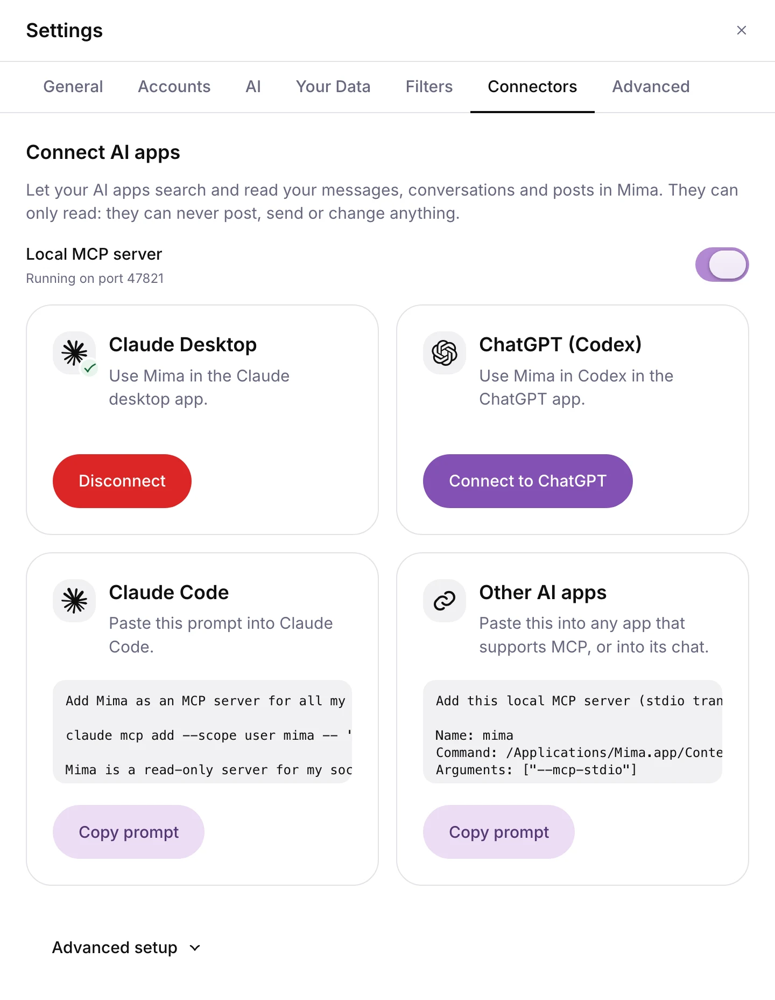

Select **Connect Mima to your agent** in the top right of Mima, or open **Settings > Connectors**. Each app has its own card:

| App | How it connects |
|---|---|
| Claude Desktop | One click: **Connect to Claude Desktop**. |
| Codex in the ChatGPT app | One click: **Connect to ChatGPT**. This also covers the Codex command line and editor extension. |
| Claude Code | Copy a prompt and paste it into Claude Code. |
| Goose and other apps that support local MCP | Copy a prompt for the app's chat or settings, from the **Other AI apps** card. |

To connect Claude Desktop:

1. Open Mima, then **Settings > Connectors**.
2. Select **Connect to Claude Desktop**. Mima turns its server on and adds itself to Claude Desktop's settings.
3. When Mima says it is done, quit Claude Desktop completely (Cmd+Q) and open it again. Mima's tools appear in a new chat.

Mima has to be open while your agent uses it. Once an agent is connected, the button in the top right changes to say so.
