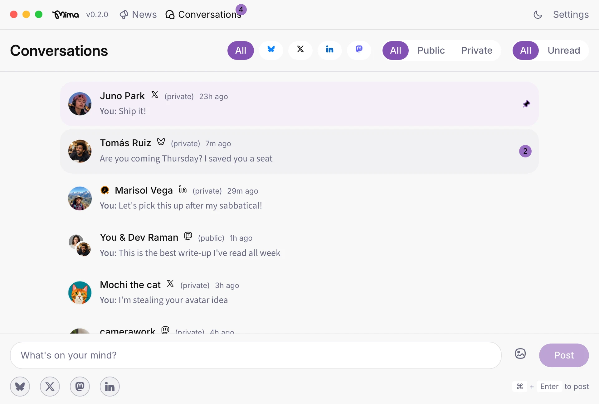
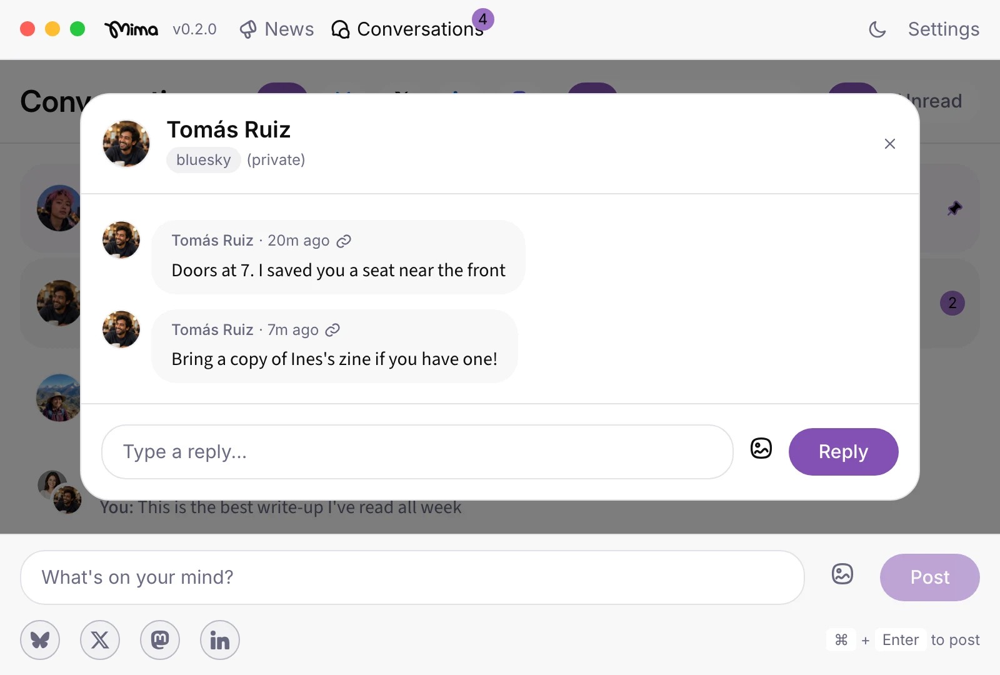
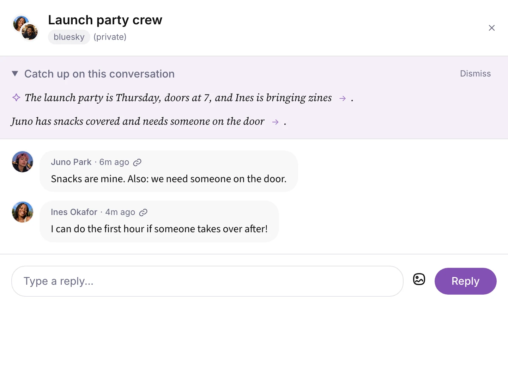

## TL;DR

- Mima brings mentions and DMs from Bluesky, X, LinkedIn, and Mastodon into one local unified inbox. You can read them and reply to them across all four networks.
- Reply to people, pin conversations that matter, and set reminders to follow up. Mima helps professionals build relationships and brand trust through consistent engagement.
- Mima runs on your Mac, and all your content goes directly to the app without passing through Mima servers.

## What makes an inbox "unified" and why you need one

A unified inbox brings messages and mentions from separate social accounts into one view. [Mima](https://www.mima.social) gives Apple Silicon Mac users a place to keep up with conversations across networks, then reply or return to a thread later. For a developer advocate answering a technical question, an influencer manager staying close to creator relationships, or a professional expanding a network, the value is the connection built through follow-up, not a larger pile of posts to scan.

## A day in Mima's unified inbox: read, reply, pin, remind

Open Mima’s unified inbox and check mentions and DMs across Bluesky, X, LinkedIn, and Mastodon. A developer advocate might answer a LinkedIn question from someone evaluating a product, then reply to a Bluesky DM from a developer they met at a conference. Pin an X thread that needs a thoughtful response, and set a reminder to return to a Mastodon discussion. Reading, replying, and following up across networks helps people recognize a responsive voice over time, whether you represent a brand or build your own professional network.

## How Mima keeps your conversations private

Mima's account content travels directly between your social accounts and the app on your Mac, without passing through Mima servers. Mima has no servers that store your private or public messages. What you say stays between you and your social network.

Mima does not store your account passwords. You sign in through each network’s own login, and Mima keeps you signed in on your Mac.

AI features are off until you set them up. If you download Mima’s local model, it runs on your Mac, including when you are offline. If you instead add your own OpenAI, Anthropic, or Google API key, content you use with that provider goes to its servers.

Every Mima release is code-signed and checked by Apple before it reaches your Mac. Those checks provide a way to verify the app’s developer and screen the software.

## Getting started with Mima on an Apple Silicon Mac

Mima is free and available for Apple Silicon Macs. Visit [Mima’s homepage](https://www.mima.social) on your Mac and select Download for Mac. If you’re on your phone, Mima can email you the download link instead, so you can install it when you’re at your computer. After installation, connect your accounts using each network’s own sign-in.

## Mima for professional engagement vs. enterprise support

Mima fits a person who needs to keep conversations moving across accounts, whether the goal is a stronger professional network, creator relationships, or trust in a brand. An enterprise customer-service inbox serves a different job: routing incoming requests among agents and tracking support work through team systems. If your work depends on team assignment or CRM integration, choose a dedicated enterprise tool; if it depends on showing up and following up yourself, Mima keeps those conversations together on your Mac.

## Where Mima fits next to open-source and self-hosted alternatives

[Mima](https://www.mima.social) runs locally on an Apple Silicon Mac and brings conversations into a social media inbox for people who manage relationships across networks, including professionals who represent a brand. Account content goes directly to the app without passing through Mima servers. Mima is neither open source nor self-hosted.

Flare takes a different approach as an open-source multi-network client. Its code may interest you if you want to inspect the software you use, but check the release you plan to install for its current network and inbox support.

Mixpost serves a different job again. Its self-hosted option lets you run a social publishing and scheduling tool on your own server. If your main task is keeping up with conversations on your Mac, Mima fits that use case more directly. For a closer comparison, see [Private Social Account Managers: Local Desktop vs Self-Hosted Tools](/learn/private-social-account-managers/).

## FAQs

**Which networks does Mima support?** Mima connects Bluesky, X, LinkedIn, and Mastodon accounts. Its social media inbox brings their mentions and DMs into one place.

**Can I connect Instagram, Facebook, or TikTok?** No. Mima does not support those networks.

**Can I read and reply to DMs on all four supported networks?** Yes. You can read and reply to mentions and DMs from Bluesky, X, LinkedIn, and Mastodon in Mima.

**Does my account content leave my Mac?** Account content comes directly to the desktop app and never passes through Mima servers. Crash reports and anonymous usage data, which you choose whether to share, never include what you read or write. Using a third-party AI provider sends the content you use with it to that provider.

**Is Mima free, and which Macs can run it?** Mima is free and available for Apple Silicon Macs.

**Is Mima open source or self-hosted?** No. Mima is a local desktop app, not an open-source or self-hosted service.

**Who is Mima for, and is it an enterprise customer-service inbox?** Mima suits individuals managing conversations for themselves or a brand, including developer advocates, influencer managers, and professionals building an online network. For team routing or CRM-led support, choose a dedicated enterprise inbox.

## Try Mima's unified inbox on your Mac

Mima helps Apple Silicon Mac users stay present in conversations that build professional relationships and brand trust. Whether you manage creator relationships or engage with a developer community, [download Mima](https://www.mima.social) to keep those conversations in one private inbox.
