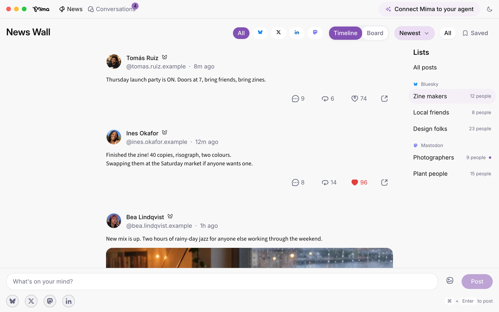

## TL;DR

- [Mima](https://www.mima.social) imports your lists from Bluesky and Mastodon. They appear next to the Timeline, grouped by network.
- Select a list to see only posts from the people on it. Select **All posts** to return to everyone you follow.
- Lists are read-only in Mima. You still create and edit them on Bluesky or Mastodon, and Mima picks up the changes.
- Lists arrived in Mima 0.7.0, released on 22 November 2026.

## Where your lists appear in Mima

Connect your Bluesky or Mastodon account and Mima imports that account's lists when it syncs. There is nothing to set up.

Open the News Wall in its Timeline view. In a wide window, a **Lists** column sits to the right of your feed. In a narrower window, the same choice moves into a **Lists** menu at the top of the News Wall. Each list shows the network it came from and how many people are on it.

If you have no lists on either network, Mima shows the Timeline as before, with no empty column.

## Reading one list at a time

Select a list and the Timeline narrows to posts from its members. Select **All posts** to go back to the whole feed. Mima remembers the list you chose.

A list from Bluesky shows Bluesky posts, and a list from Mastodon shows Mastodon posts. Lists stay with their own network, as they do on the networks themselves.

## Calm by design: a dot, never a count

Mima does not put unread counts on lists. A list with posts since you last opened it gets one small dot, and the dot clears once you have read the list and moved on. The only number beside a list is its size.

The Timeline is quiet in the same way. While you are scrolled down reading, new posts wait behind a small button that says how many have arrived, such as "3 new posts". Select it to jump to the top and see them. Your place never moves under you.

## What lists in Mima don't do yet

- **Editing.** You cannot create a list, rename one, or add and remove people in Mima. Make the change on Bluesky or Mastodon, and it shows up in Mima after the next sync. Mima never changes your lists on the network.
- **X and LinkedIn.** Lists come from Bluesky and Mastodon. X lists are not imported yet.
- **Mixed lists.** A list cannot combine people from several networks.
- **Board view.** Lists filter the Timeline, not the Board.

If you need to build cross-network groups of accounts today, a client with its own list editor will fit better. If you already keep lists on Bluesky and Mastodon and want them next to the rest of your feed, Mima shows them as they are.

## FAQ

**Do I have to import my lists by hand?** No. Mima brings in your Bluesky and Mastodon lists when it syncs those accounts.

**Can I edit a list in Mima?** No. Lists are read-only in Mima. Edit them on Bluesky or Mastodon.

**I deleted a list on Bluesky. Will it stay in Mima?** No. It disappears from Mima after the next sync.

**Does Mima import X lists?** Not yet.

**Why can't I see a Lists column?** It appears in the Timeline view once a connected Bluesky or Mastodon account has at least one list. In a narrow window, look for the **Lists** menu at the top of the News Wall.

**Which version of Mima do I need?** Mima 0.7.0 or later, on an Apple Silicon Mac.
